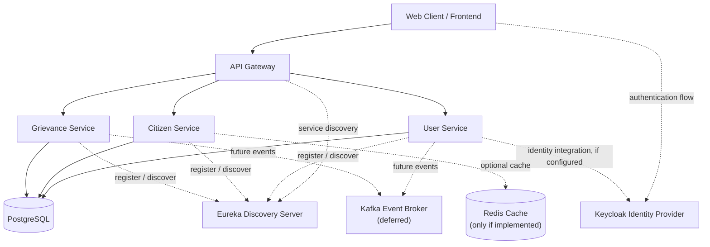

# CivicPulse Nexus

### A Microservices-Based Digital Governance Platform

CivicPulse Nexus is a software engineering project focused on organizing
citizen-facing services and public grievance workflows through a modular
backend. The project is being developed around independently organized
services for user management, citizen profiles, and grievance handling,
with an API Gateway as the entry point for client requests.

> **Project status:** Backend development is in progress. This README
> distinguishes the planned target architecture from integrations and
> features that should only be described as complete after they have
> been verified in the repository. Update the status notes and examples
> below to match the latest code before publishing the repository.

## Contents

-   [Project Overview](#project-overview)
-   [Goals](#goals)
-   [Features and Service
    Responsibilities](#features-and-service-responsibilities)
-   [Technology Stack](#technology-stack)
-   [Architecture](#architecture)
-   [Repository Structure](#repository-structure)
-   [Getting Started](#getting-started)
-   [Configuration](#configuration)
-   [Running the Services](#running-the-services)
-   [API Testing](#api-testing)
-   [Screenshots and Demo](#screenshots-and-demo)
-   [Engineering Practices](#engineering-practices)
-   [Roadmap](#roadmap)
-   [Contributing](#contributing)
-   [License](#license)

## Project Overview

Public-service workflows can involve multiple departments, user records,
and status updates. CivicPulse Nexus explores how a modular application
can make these workflows easier to manage and extend.

The backend is organized as a Maven multi-module project. The planned
service boundaries separate authentication and user information, citizen
profile data, and grievance processing. An API Gateway provides a common
entry point, while service discovery is part of the target architecture.

### Project goals

-   Organize backend responsibilities into focused services.
-   Expose HTTP APIs for client applications and service consumers.
-   Keep service configuration and module boundaries maintainable.
-   Build a foundation for authorization and service discovery.
-   Make it easier to add further civic workflows after the core backend
    is stable.

## Features and Service Responsibilities

The following table describes the intended responsibilities. Treat a
feature as **implemented** only when it is present and testable in the
current repository.

  ------------------------------------------------------------------------
  Component               Responsibility           Verification status
  ----------------------- ------------------------ -----------------------
  User Service            User registration,       Verify against current
                          login, identity data,    code
                          roles, and               
                          authentication-related   
                          endpoints                

  Citizen Service         Citizen profile details, Verify against current
                          contact information,     code
                          address, and             
                          ward-related data        

  Grievance Service       Complaint records,       Core service under
                          grievance status,        development; verify
                          department/officer       endpoints
                          assignment, and          
                          resolution workflow      

  API Gateway             Single entry point and   Verify configured
                          routing of client        routes
                          requests to backend      
                          services                 

  Discovery Server        Service registration and Target architecture;
  (Eureka)                discovery                verify before claiming
                                                   complete

  Keycloak                Identity and access      Target architecture;
                          management               verify integration
                                                   before claiming
                                                   complete

  PostgreSQL              Relational persistence   Verify schemas,
                          for service data         connections, and
                                                   migrations

  Kafka                   Asynchronous events      Deferred until core
                          between services         backend work is
                                                   complete

  Redis                   Caching or other         Include only if the
                          low-latency data access  repository contains a
                                                   working integration
  ------------------------------------------------------------------------

### Current implementation notes

-   Kafka was intentionally deferred while the core backend is being
    completed.
-   Do not present Redis, Keycloak, Eureka, or any additional service as
    fully integrated unless its configuration and runtime behavior have
    been verified.
-   If a service currently has only a skeleton or sample endpoint,
    describe it as in progress rather than production-ready.

## Technology Stack

  -----------------------------------------------------------------------
  Area                                Technology
  ----------------------------------- -----------------------------------
  Language                            Java 25

  Backend framework                   Spring Boot

  Build and dependency management     Apache Maven

  API style                           REST over HTTP

  Architecture                        Modular backend /
                                      microservices-oriented design

  Edge routing                        Spring Cloud Gateway (verify exact
                                      dependency and configuration)

  Service discovery                   Netflix Eureka (target
                                      architecture; verify
                                      implementation)

  Identity and access management      Keycloak (target architecture;
                                      verify implementation)

  Database                            PostgreSQL (verify service-level
                                      configuration)

  Frontend                            React, if included in the current
                                      repository

  Event streaming                     Apache Kafka --- planned after core
                                      backend completion

  Caching                             Redis --- document only after a
                                      working integration exists
  -----------------------------------------------------------------------

## Architecture

### Target architecture

The diagram below documents the intended architecture, not a guarantee
that every integration is already running. Solid connections show the
main request path; dashed connections indicate integrations or
extensions that should be marked complete only after verification.



**Important:** The diagram is a target/reference architecture. Adjust
the database connections to match the actual per-service database setup.
If services do not yet use Eureka or Keycloak, keep those components
labeled as planned. Kafka is shown as deferred, not as an active
dependency. Remove Redis from the diagram if it is not implemented.

### Request flow

1.  A client sends an HTTP request to the API Gateway.
2.  The Gateway routes the request to the relevant backend service,
    according to its configured routes.
3.  The selected service validates the request and performs its business
    operation.
4.  The service reads or writes data using its configured persistence
    layer.
5.  The service returns an HTTP response through the Gateway to the
    client.

The exact routing, authentication, and persistence behavior depends on
the current configuration and should be verified before describing it as
complete.

## Repository Structure

The planned Maven parent-project structure is:

``` text
civicpulse/
├── pom.xml
├── common-library/
├── discovery-server/
├── api-gateway/
├── user-service/
├── citizen-service/
├── grievance-service/
├── README.md
└── docs/
    └── architecture.md
```

This is the intended module layout from the project plan. Keep the
README synchronized with the actual repository folders; remove modules
that do not exist and add any that have since been created.

### Module purpose

-   `common-library/` --- shared code and common utilities, if required.
-   `discovery-server/` --- Eureka server configuration, if implemented.
-   `api-gateway/` --- API entry point and route configuration.
-   `user-service/` --- user-related operations.
-   `citizen-service/` --- citizen profile operations.
-   `grievance-service/` --- grievance lifecycle operations.

## Getting Started

### Prerequisites

Install the versions and tools required by the current project:

-   JDK 25
-   Apache Maven, or use the Maven Wrapper if the repository includes it
-   PostgreSQL, if required by the services being run
-   Git
-   An API client such as Postman or `curl`

If the project uses Docker Compose or a local identity provider, add the
required setup steps here.

### 1. Clone the repository

Replace the placeholder URL with the actual repository URL.

``` bash
git clone <YOUR_REPOSITORY_URL>
cd civicpulse
```

### 2. Check Java and Maven

``` bash
java -version
mvn -version
```

Confirm that the active Java version is compatible with the project's
Maven configuration.

### 3. Configure the database

Create the required PostgreSQL database or databases based on the
service configuration. Set credentials through environment variables or
local, untracked configuration files. Do not commit passwords, tokens,
or production connection strings.

Example environment-variable names (use the exact names expected by your
application):

``` text
DB_HOST=localhost
DB_PORT=5432
DB_NAME=<your_database_name>
DB_USERNAME=<your_database_username>
DB_PASSWORD=<your_local_password>
```

These are illustrative names, not guaranteed application property names.
Check each service's `application.yml` or `application.properties`
before using them.

### 4. Build the project

From the Maven parent directory:

``` bash
mvn clean install
```

If the project uses a Maven Wrapper, you can use `./mvnw clean install`
on Linux/macOS or `mvnw.cmd clean install` on Windows.

Resolve any build errors before starting the services. If a module is
not yet included in the parent `pom.xml`, update this section to reflect
the actual build procedure.

## Configuration

Spring Boot configuration is commonly held in each service's
`src/main/resources/application.yml` or `application.properties`.

Before starting the application, verify:

-   The server port for each service.
-   The Gateway's route destinations and path predicates.
-   PostgreSQL URL, username, and password.
-   Eureka client/server settings, if enabled.
-   Keycloak issuer, realm, client, and security settings, if enabled.
-   CORS settings required by the frontend, if applicable.

Do not assume that two services use the same port. Use the configured
port for each service and keep the ports documented here up to date.

## Running the Services

Start only the modules and dependencies that are configured and working
in your current checkout. The sequence below is a general guide, not a
verified command sequence for this repository.

1.  Start PostgreSQL.
2.  Start Eureka Discovery Server, if implemented and required.
3.  Start the User Service.
4.  Start the Citizen Service.
5.  Start the Grievance Service.
6.  Start the API Gateway.
7.  Start the frontend, if included.

For a service that is a standalone Maven module, the general command is:

``` bash
mvn spring-boot:run
```

Run it from that service's module directory, or use the parent build
configuration if the project supports it. Confirm the actual startup
command in the module's `pom.xml` and documentation.

### Service endpoints

Fill in the actual ports and routes after checking the configuration:

  Component           Local base URL
  ------------------- -------------------------------------------------
  API Gateway         `http://localhost:<gateway-port>`
  User Service        `http://localhost:<user-service-port>`
  Citizen Service     `http://localhost:<citizen-service-port>`
  Grievance Service   `http://localhost:<grievance-service-port>`
  Eureka Dashboard    `http://localhost:<eureka-port>` --- if enabled

Avoid documenting direct service URLs as the recommended client entry
point if requests are intended to go through the Gateway.

## API Testing

Use Postman, `curl`, or automated integration tests to verify endpoints
that exist in the current code. Include only tested routes in the final
README.

Example request format:

``` bash
curl -i "http://localhost:<gateway-port>/<configured-route>"
```

Replace the placeholders with a real route and port from the Gateway
configuration. For each important endpoint, document:

-   HTTP method and path
-   Required headers and authentication
-   Request body, if applicable
-   Successful response and status code
-   Validation and error responses

A successful response from a direct service does not by itself prove
that Gateway routing, authentication, or service discovery is working.
Test each layer independently.

## Screenshots and Demo

Add screenshots to a `docs/images/` folder and reference them from this
README. Use screenshots from the actual running application---do not use
mockups as proof of implemented functionality.

Suggested evidence:

1.  **Application overview:** landing page or main dashboard.
2.  **API testing:** a successful request and response in Postman.
3.  **Service discovery:** registered services in Eureka, if enabled.
4.  **Database evidence:** a relevant schema or sample record, with
    private data hidden.
5.  **Grievance workflow:** a real end-to-end flow, once implemented.

Example Markdown for a screenshot:

``` markdown

```

If there is no frontend yet, use genuine API request/response
screenshots and an architecture diagram instead.

## Engineering Practices

The project is intended to demonstrate:

-   Clear service boundaries and modular code organization.
-   REST API design and appropriate HTTP status codes.
-   Externalized configuration and protection of secrets.
-   Input validation and consistent error handling.
-   Separation of business logic from controllers and persistence code.
-   Automated tests for service logic and API behavior.
-   Documented setup steps that another developer can reproduce.

Only list testing, security, CI/CD, containerization, or
production-readiness practices that are actually present in the
repository.

## Roadmap

-   [x] Define core service boundaries for users, citizens, and
    grievances.
-   [ ] Complete and verify core backend APIs.
-   [ ] Verify Gateway routing through end-to-end API tests.
-   [ ] Complete and verify persistence configuration.
-   [ ] Integrate and test Eureka service discovery.
-   [ ] Integrate and test Keycloak authentication and authorization.
-   [ ] Add automated unit and integration tests.
-   [ ] Add screenshots and a reproducible local setup.
-   [ ] Consider Kafka-based asynchronous events after core backend
    completion.
-   [ ] Add Redis only if a concrete caching requirement is identified
    and implemented.

Update the checklist based on actual progress; do not leave a task
checked unless the corresponding work is present and verified.

## Contributing

This is a learning and portfolio project. For changes, create a focused
branch, make the smallest coherent change, run the relevant tests, and
document any configuration changes.

## License

No license has been specified yet. Add a `LICENSE` file and name the
license here before presenting the repository as open source.
